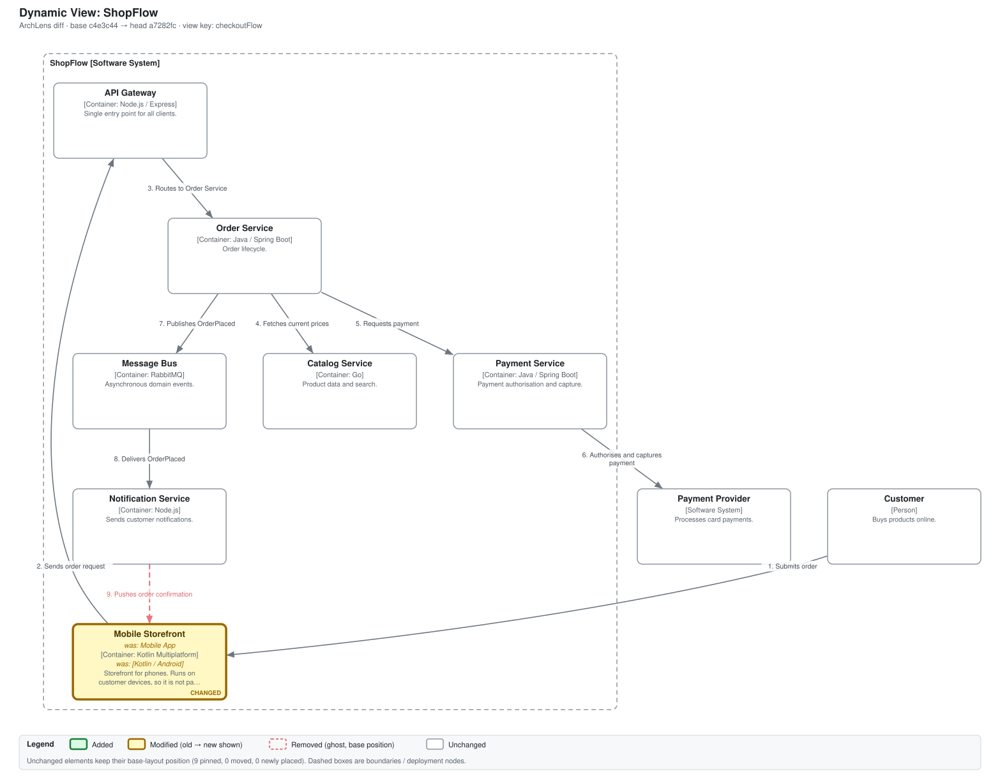
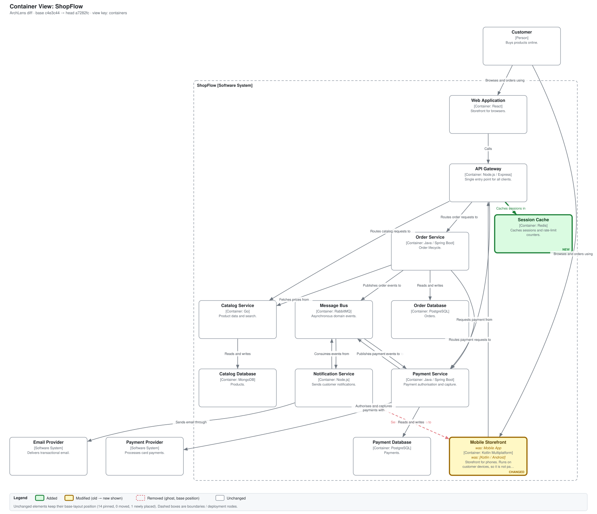
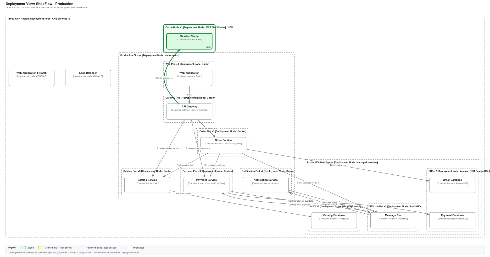

<!-- archlens-diff-comment -->
## ArchLens: architecture changes in this PR

**Summary:** elements: 1 added, 1 modified · relationships: 1 added, 1 removed · deployment nodes: 1 added · deployment instances: 1 added · 3 of 7 views affected · R1 pass

**R1 (compose services ↔ model containers): ✅ pass**

### Changes

**Elements**
- ➕ added container **Session Cache** (`cache`)
- ✏️ modified container **Mobile Storefront** (`mobileApp`): name `Mobile App` → `Mobile Storefront`, technology `Kotlin / Android` → `Kotlin Multiplatform`

**Relationships**
- ➕ added `apiGateway` → `cache` "Caches sessions in" [RESP]
- ➖ removed `notificationService` → `mobileApp` "Sends push notifications to" [FCM]

**Deployment nodes**
- ➕ added deploymentNode **Cache Node** (`productionCacheNode`, Production)

**Deployment instances**
- ➕ added containerInstance **Session Cache** (`productionCache`, Production)

### Affected views (3)

#### `checkoutFlow` — Dynamic View: ShopFlow

- modified: container Mobile Storefront (name: "Mobile App" → "Mobile Storefront", technology: "Kotlin / Android" → "Kotlin Multiplatform")
- relationship removed: Notification Service → Mobile Storefront "Sends push notifications to"



#### `containers` — Container View: ShopFlow

- added: container Session Cache
- modified: container Mobile Storefront (name: "Mobile App" → "Mobile Storefront", technology: "Kotlin / Android" → "Kotlin Multiplatform")
- relationship added: API Gateway → Session Cache "Caches sessions in"
- relationship removed: Notification Service → Mobile Storefront "Sends push notifications to"



#### `productionDeployment` — Deployment View: ShopFlow - Production

- added: containerInstance Session Cache
- added: deploymentNode Cache Node
- 1 derived relationship(s) added (implied between instances/parents)



Not affected, not re-rendered: `orderComponents`, `paymentComponents`, `stagingDeployment`, `systemContext`

<details><summary>Raw delta JSON</summary>

```json
{
  "schema": "archlens-delta/1",
  "tooling": {
    "graphviz": "dot - graphviz version 2.43.0 (0)",
    "node": "v24.22.1"
  },
  "identity": {
    "field": "model element `properties[\"structurizr.dsl.identifier\"]` (DSL identifier); relationships: source identity + destination identity + description; numeric export ids are never used",
    "base": {
      "dsl": 76,
      "path": 0
    },
    "head": {
      "dsl": 79,
      "path": 0
    }
  },
  "summary": "elements: 1 added, 1 modified · relationships: 1 added, 1 removed · deployment nodes: 1 added · deployment instances: 1 added · 3 of 7 views affected · R1 pass",
  "elements": {
    "added": [
      {
        "id": "cache",
        "kind": "container",
        "name": "Session Cache",
        "parent": "shop"
      }
    ],
    "removed": [],
    "modified": [
      {
        "id": "mobileApp",
        "kind": "container",
        "name": "Mobile Storefront",
        "parent": "shop",
        "changes": [
          {
            "field": "name",
            "from": "Mobile App",
            "to": "Mobile Storefront"
          },
          {
            "field": "technology",
            "from": "Kotlin / Android",
            "to": "Kotlin Multiplatform"
          }
        ]
      }
    ]
  },
  "relationships": {
    "added": [
      {
        "key": "apiGateway|cache|Caches sessions in",
        "src": "apiGateway",
        "dst": "cache",
        "description": "Caches sessions in",
        "technology": "RESP"
      }
    ],
    "removed": [
      {
        "key": "notificationService|mobileApp|Sends push notifications to",
        "src": "notificationService",
        "dst": "mobileApp",
        "description": "Sends push notifications to",
        "technology": "FCM"
      }
    ],
    "modified": []
  },
  "deployment": {
    "nodes": {
      "added": [
        {
          "id": "productionCacheNode",
          "kind": "deploymentNode",
          "name": "Cache Node",
          "environment": "Production",
          "parent": "productionRegion"
        }
      ],
      "removed": [],
      "modified": []
    },
    "instances": {
      "added": [
        {
          "id": "productionCache",
          "kind": "containerInstance",
          "name": "Session Cache",
          "environment": "Production",
          "parent": "productionCacheNode"
        }
      ],
      "removed": [],
      "modified": []
    }
  },
  "views": [
    {
      "key": "checkoutFlow",
      "kind": "dynamic",
      "title": "Dynamic View: ShopFlow",
      "status": "changed",
      "affected": true,
      "reasons": [
        "modified: container Mobile Storefront (name: \"Mobile App\" → \"Mobile Storefront\", technology: \"Kotlin / Android\" → \"Kotlin Multiplatform\")",
        "relationship removed: Notification Service → Mobile Storefront \"Sends push notifications to\""
      ]
    },
    {
      "key": "containers",
      "kind": "container",
      "title": "Container View: ShopFlow",
      "status": "changed",
      "affected": true,
      "reasons": [
        "added: container Session Cache",
        "modified: container Mobile Storefront (name: \"Mobile App\" → \"Mobile Storefront\", technology: \"Kotlin / Android\" → \"Kotlin Multiplatform\")",
        "relationship added: API Gateway → Session Cache \"Caches sessions in\"",
        "relationship removed: Notification Service → Mobile Storefront \"Sends push notifications to\""
      ]
    },
    {
      "key": "orderComponents",
      "kind": "component",
      "title": "Component View: ShopFlow - Order Service",
      "status": "unchanged",
      "affected": false,
      "reasons": []
    },
    {
      "key": "paymentComponents",
      "kind": "component",
      "title": "Component View: ShopFlow - Payment Service",
      "status": "unchanged",
      "affected": false,
      "reasons": []
    },
    {
      "key": "productionDeployment",
      "kind": "deployment",
      "title": "Deployment View: ShopFlow - Production",
      "status": "changed",
      "affected": true,
      "reasons": [
        "added: containerInstance Session Cache",
        "added: deploymentNode Cache Node",
        "1 derived relationship(s) added (implied between instances/parents)"
      ]
    },
    {
      "key": "stagingDeployment",
      "kind": "deployment",
      "title": "Deployment View: ShopFlow - Staging",
      "status": "unchanged",
      "affected": false,
      "reasons": []
    },
    {
      "key": "systemContext",
      "kind": "systemContext",
      "title": "System Context View: ShopFlow",
      "status": "unchanged",
      "affected": false,
      "reasons": []
    }
  ],
  "rules": [
    {
      "rule": "R1",
      "passed": true,
      "messages": []
    }
  ],
  "rendering": [
    {
      "view": "checkoutFlow",
      "nodes": 9,
      "pinned": 9,
      "movedUnchanged": 0,
      "newlyPlaced": [],
      "image": "images/checkoutFlow.svg"
    },
    {
      "view": "containers",
      "nodes": 15,
      "pinned": 14,
      "movedUnchanged": 0,
      "newlyPlaced": [
        "cache"
      ],
      "image": "images/containers.svg"
    },
    {
      "view": "productionDeployment",
      "nodes": 13,
      "pinned": 12,
      "movedUnchanged": 0,
      "newlyPlaced": [
        "productionCache"
      ],
      "image": "images/productionDeployment.svg"
    }
  ]
}

```

</details>

<sub>ArchLens POC · deterministic, no LLM · base `base c4e3c44` → head `head a7282fc`</sub>

Determinism: ran twice on the same inputs, SVG set hash `03df3d4a8b597715` both times (Graphviz version 2.43.0).
