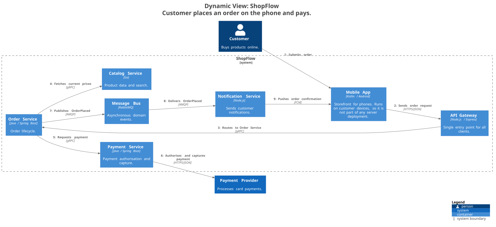
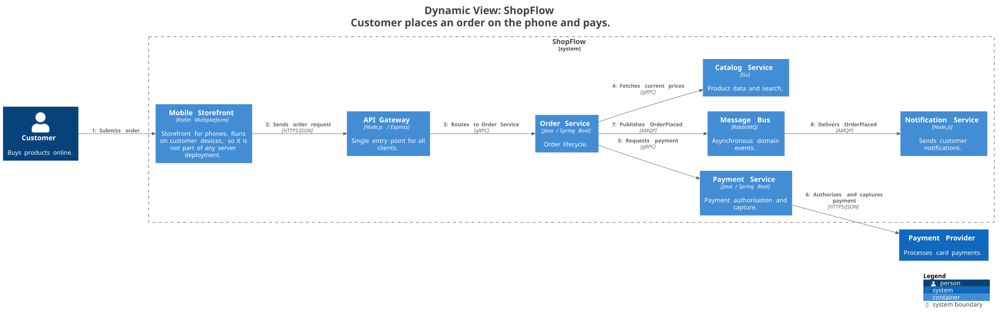
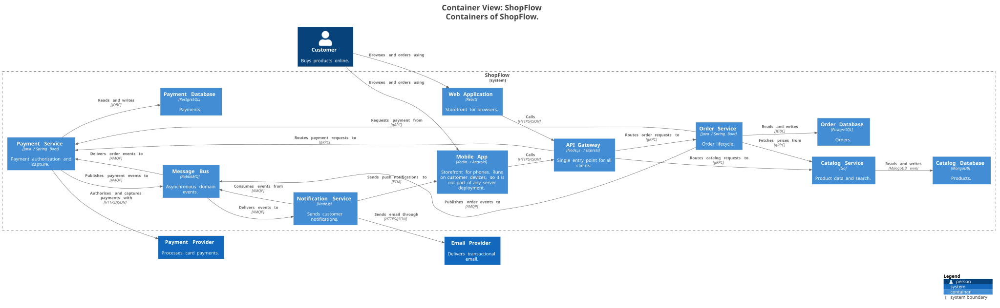
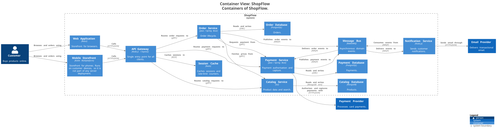
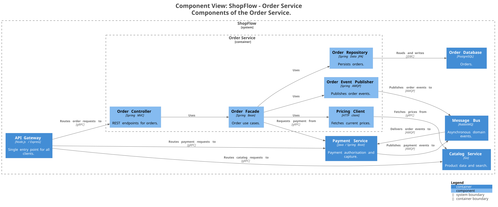
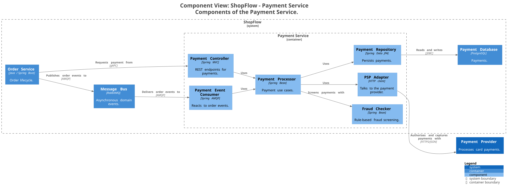
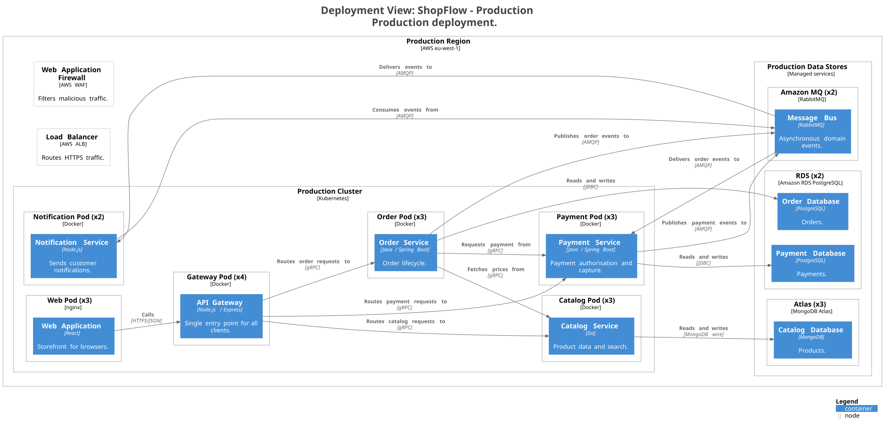
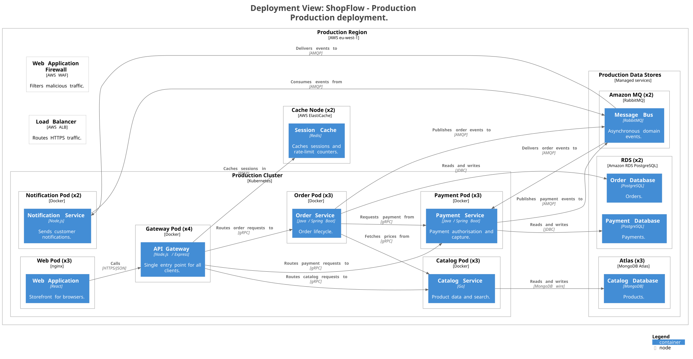
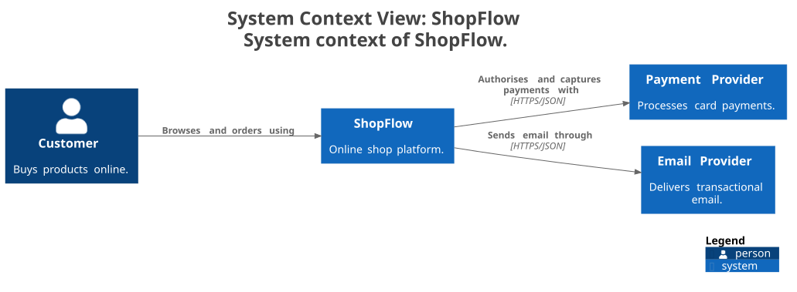

<!-- archlens-baseline-render-comment -->
## Baseline: rendered diagrams (before / after)

Plain render job: Structurizr export to C4-PlantUML, PlantUML default auto-layout, every view rendered for base (`c4e3c44`) and head (`a7282fc`). Nothing is filtered or highlighted; each image is laid out independently.

### `checkoutFlow`

**Before** (base `c4e3c44`)

**After** (head `a7282fc`)

### `containers`

**Before** (base `c4e3c44`)

**After** (head `a7282fc`)

### `orderComponents`

**Before** (base `c4e3c44`)

**After** (head `a7282fc`)

### `paymentComponents`

**Before** (base `c4e3c44`)

**After** (head `a7282fc`)

### `productionDeployment`

**Before** (base `c4e3c44`)

**After** (head `a7282fc`)

### `stagingDeployment`

**Before** (base `c4e3c44`)

**After** (head `a7282fc`)

### `systemContext`

**Before** (base `c4e3c44`)

**After** (head `a7282fc`)

