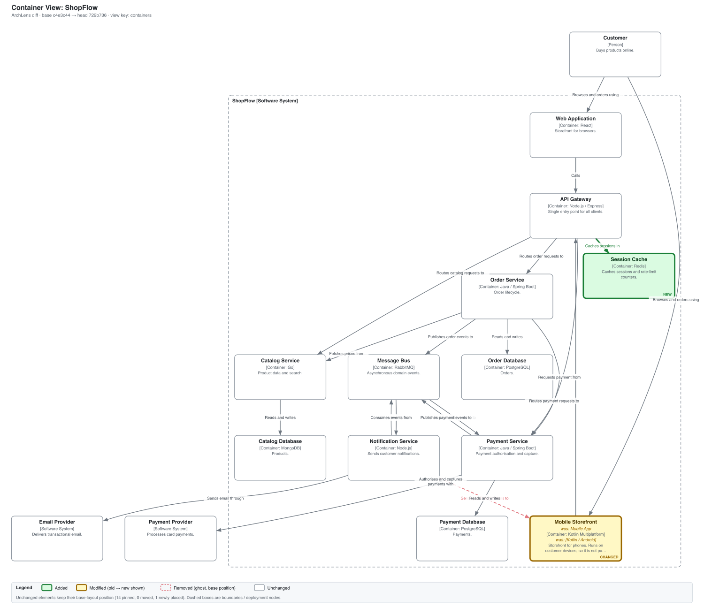
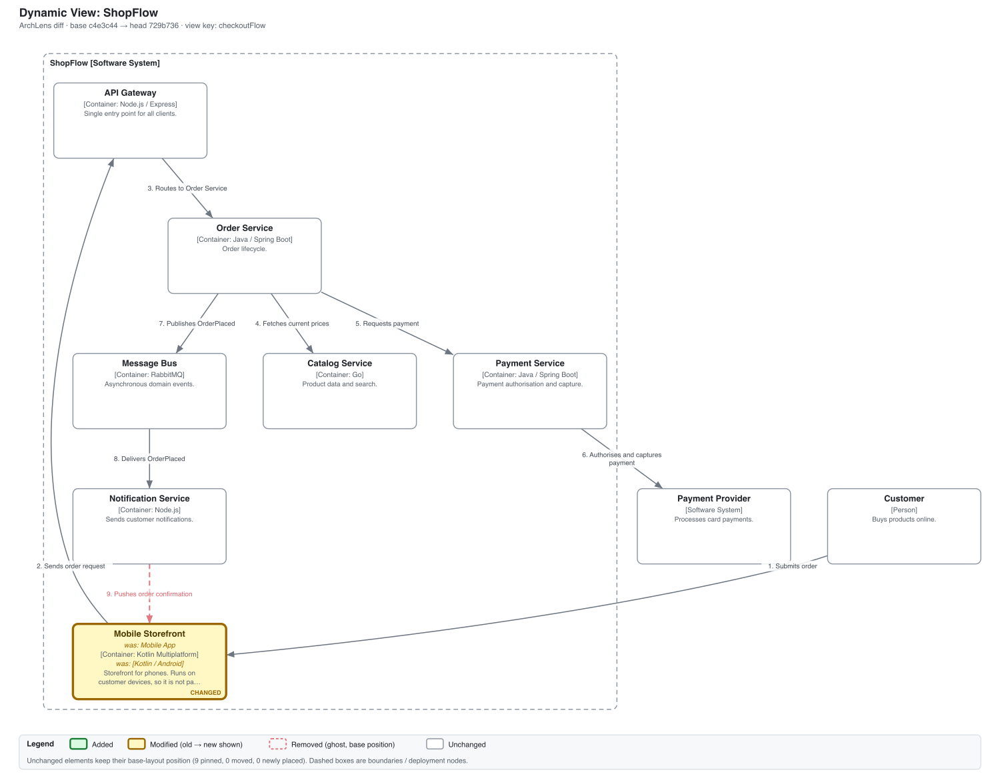
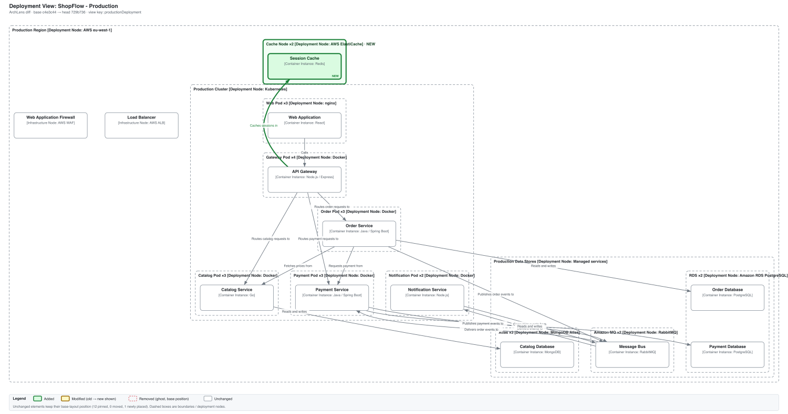
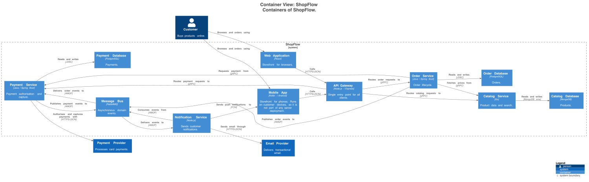
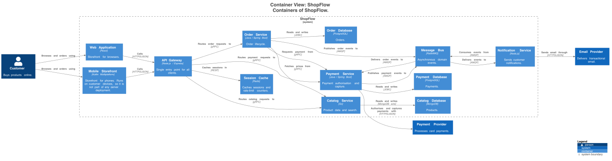

# POC comparison: B1 text diff, B2 rendered before/after, A ArchLens

Demo PR: <https://github.com/leitsyshyn/archlens-poc/pull/1>. Evaluation protocol: spec section 9.
The PR has two states, both kept: **first head** `729b736` (`archlens/model-diff` **failed**, change 5) and **after the fix** `a7282fc`
(compose aligned, check **passed**). Scores below use the first head, which contains all five changes.
B3 (CodeRabbit) was **not run**: it needs a browser install by the user (steps in the README), so it is `n/a` everywhere.

Outputs on the PR:

- B1: [Files changed](https://github.com/leitsyshyn/archlens-poc/pull/1/files). 6 hunks (5 in `model/workspace.dsl`, 1 in `deploy/docker-compose.yml`).
- B2: [comment](https://github.com/leitsyshyn/archlens-poc/pull/1#issuecomment-6542702637). 7 views x 2 images = 14 images. First-head copy: [`evidence/b2-comment-first-head-729b736.md`](evidence/b2-comment-first-head-729b736.md).
- A: [comment](https://github.com/leitsyshyn/archlens-poc/pull/1#issuecomment-6542707305) (updated in place on every push; it now shows the passing state). First-head copy: [`evidence/a-comment-first-head-729b736.md`](evidence/a-comment-first-head-729b736.md). 3 images.
- Check `archlens/model-diff`: [failing on `729b736`](evidence/check-run-first-head-729b736.json), [passing on `a7282fc`](evidence/check-run-after-fix-a7282fc.json).
- Whole-page screenshots: [first head, check failing](images/pr-page-first-head-check-failing.png) (shows the inline images rendering on github.com), [after the fix, check passing](images/pr-page-after-fix-check-passing.png).

## Scoring (per change, first head)

Columns follow section 9: Visible (yes / partially / no), Located (does the output say which views are affected), Effort (hunks or images to inspect, counted for a reviewer who is told where to look; B2 is 14 images for a reviewer who is not), Stability, Drift.

| Change | Output | Visible | Located | Effort | Stability (unchanged elements that moved) | Drift reported |
|---|---|---|---|---|---|---|
| **1 Rename** `mobileApp` + technology | B1 | yes (name and technology on one changed line) | no | 1 hunk | n/a | n/a |
| | B2 | partially: the new name is in the head images, but nothing marks it as changed; you must recall or open the base image | no | 4 images (2 pairs: `containers`, `checkoutFlow`) | `containers` 13 of 13, `checkoutFlow` 8 of 8 | n/a |
| | A | yes, amber box with `was: Mobile App` and `was: [Kotlin / Android]`, one modified element (not remove + add) | yes: `containers`, `checkoutFlow`, with reasons | 2 images | 0 of 14, 0 of 9 | n/a |
| **2 Add** `cache` + relationship | B1 | yes | no | 2 hunks | n/a | n/a |
| | B2 | yes: a new box and edge in the head `containers` image, not marked as new | no | 2 images (1 pair) | as above (13 of 13 moved) | n/a |
| | A | yes, green box and edge | yes: `containers` | 1 image | 0 (new node placed beside `apiGateway`) | n/a |
| **3 Remove** relationship used by the dynamic view | B1 | yes: the relationship line and the dynamic step are both deleted (two hunks; the second is the hint that the dynamic view is affected, if you know how dynamic views work) | no | 2 hunks | n/a | n/a |
| | B2 | partially: an edge is absent in head `containers` and `checkoutFlow`; spotting a missing line needs a side-by-side compare | no | 4 images | `containers` 13 of 13, `checkoutFlow` 8 of 8 | n/a |
| | A | yes, red dashed ghost edge at its base position, labelled | yes: `checkoutFlow` and `containers` | 2 images | 0 | n/a |
| **4 Deployment**: cache in Production only | B1 | yes | no | 1 hunk | n/a | n/a |
| | B2 | yes: a "Cache Node" appears in head `productionDeployment`. `stagingDeployment` is rendered too (identical) and the reviewer must open it to learn nothing changed | no | 2 images (+2 to rule out Staging) | `productionDeployment` 12 of 12 moved (8 after removing the common shift); Staging 0 | n/a |
| | A | yes, green Cache Node x2 | yes: `productionDeployment` affected, `stagingDeployment` listed as not affected and not rendered | 1 image | 0 of 12 | n/a |
| **5 Drift**: `worker` in compose | B1 | partially: the hunk shows `worker` added, nothing says the model has no such container | no | 1 hunk | n/a | **no** |
| | B2 | no | no | 0 (nothing to find) | n/a | **no** |
| | A | yes: check failed, message names the service | n/a (not view related) | 1 message | n/a | **yes** |

Stability numbers for B2 come from the PlantUML SVGs: elements present and unchanged in base and head, matched by qualified name, counted as moved when the centre shifts by more than 5 px. The four views that were not affected render identically in B2 (0 moved), so B2's problem is limited to views that did change. For A, the tool measures the same thing against its persisted base layout and prints it in every legend: 0 moved in all three views, in CI (Graphviz 2.43) and locally (Graphviz 16.1).

Determinism: the CLI was run twice on the same inputs, once in CI (job fails if hashes differ; they matched) and once locally; SVG hashes were byte-identical both times.

## Where B2 was good enough

B2 was not weak. The PlantUML output is clean and readable, and for **additions** (changes 2 and 4) a new box with a new edge is easy to see if you open the right image. The PR is also small: B1 is six hunks and a reviewer who reads DSL gets all four model changes in a minute or two. The renders of unaffected views were identical, so the 14-image comment is noisy but not misleading. The model has only about 15 nodes per view, so re-laid-out images stay comparable by eye; I have not shown that this holds at 50 or more nodes, which is where the assessment predicts B2 breaks down.

What B2 does not do: say which views changed (the reviewer has to decide), mark anything as changed, show a **removed** edge or a **rename** except by careful comparison (13 of 13 and 8 of 8 unchanged elements moved in the two main views, so the images cannot simply be flipped between), or see the compose drift at all.

## What A added

1. **Location.** Three of seven views listed with reasons; `stagingDeployment` is explicitly not affected and is not rendered. In B2 the reviewer decides which of 14 images to open.
2. **Marking.** Rename (with old values), removal (ghost) and addition are drawn on one stable image. Removal (change 3) and rename (change 1) are where B2 is weakest, and where A is clearly better.
3. **Stability.** 0 unchanged elements moved; new nodes are placed by rule next to their neighbours. Deterministic output.
4. **Drift (change 5).** Only A reported it. Be honest about why: this comes from rule R1 (a ~30 line script comparing compose service names with container identifiers), not from the diff or the rendering. A team could get this half of the claim without any of the visual work, which supports the assessment's direction B as a separate, cheaper product.

Per the spec's criterion ("if A does not clearly win on changes 1, 3 and 5, write that down"): A does win on 3 and 5 clearly, and on 1 it wins on location and marking (B1 also shows the change in a single hunk, so the margin there is smaller). The rejection signal is **not** triggered, but this is a synthetic model with a change set designed to favour the approach, scored by its author, with no real reviewers. It shows the mechanism works; it does not show that reviewers would use it.

## What broke or was hard (for the roadmap)

- **`structurizr/cli` is a stub.** The image only prints an end-of-life banner and exits 0 without writing anything. The current distribution (`structurizr/structurizr`) exports fine.
- **Silent DSL grammar trap.** In Structurizr 6.2.4 the order is `deploymentNode name description technology tags instances`; passing the count in the tags position was accepted and produced tag `"1"` and an instance count of 1. Found only because instance counts did not show in the render.
- **Identity.** Elements and container instances carry `structurizr.dsl.identifier`, but deployment and infrastructure nodes without an explicit identifier get a random UUID there, so every node needs a named identifier in the DSL. Relationships have no identifier; identity is source + destination + description. 35 of 74 relationships in the export are derived (implied) and had to be recognised through `linkedRelationshipId`.
- **Change 3 cannot be as written in the spec.** Structurizr refuses to compile a dynamic view whose step references a removed relationship, so the PR removes the relationship and the step (two hunks). A stale reference cannot survive in a compiled model.
- **Making Staging genuinely unaffected** (change 4) constrained the model: any renamed container that is deployed in Staging, or any removed relationship between two deployed containers (it exists as implied relationships between instances), would affect Staging too. The renamed element is `mobileApp`, which runs on customer devices and is in no deployment, and the removed relationship ends there.
- **Layout.** `neato -n` ignores clusters, so boundaries are drawn by the tool from member positions; `dot` cluster margins and the tool's padding differ slightly, so one pod box clips its parent boundary in the Production image. Edge labels collide in dense areas. Layout differs between Graphviz 16.1 (local) and 2.43 (CI); it is deterministic per version only.
- **PlantUML aliases derive from names**, so a rename changes the element alias in B2; B2 cannot match elements across revisions at all.
- **Check runs** can only be created with a GitHub App token (Actions' `GITHUB_TOKEN` works; a local OAuth token does not), so the local fallback is a commit status with a 140 character description.
- **Rendering quality.** ArchLens images are rougher than PlantUML's (label overlap, estimated text widths). The claim is stability and marking, not prettier pictures.

## Images

First-head A images (CI-rendered, Graphviz 2.43): [`containers`](images/A-containers.png), [`checkoutFlow`](images/A-checkoutFlow.png), [`productionDeployment`](images/A-productionDeployment.png).
B2 for the same view, base then head: [`containers` base](images/B2-base-containers.png), [`containers` head](images/B2-head-containers.png).

